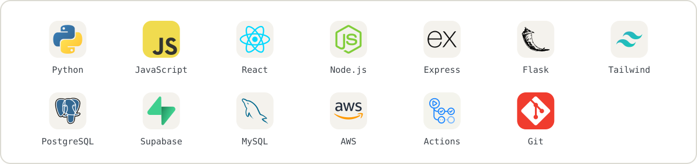
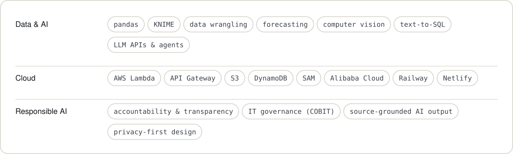

<!--
  Profile README for github.com/ItsEnChengg
  This file and the assets/ folder go in a public repo named exactly ItsEnChengg.
  The images are generated by tools/build.py (see tools/README.md).
  Stack icons are from tandpfun/skill-icons (MIT, see assets/ICONS-LICENSE.txt).
-->

  

  
  
  

 

<picture>
  <source media="(prefers-color-scheme: dark)" srcset="./assets/dark/h-about.svg" />
  
</picture>

I like building software where the AI is useful *and* checkable. Most recently I led a team of three to build a factory management information system for a real food manufacturer, with plain-English analytics, a role-aware AI assistant and in-browser person detection. Our team was picked to present it to the client.

I'm looking for a **2027 internship in applied AI or data analytics**, and after my diploma I'm aiming for a university degree in analytics or computing. I'm also a subcommittee member at NYP Cloud Computing.

 

<picture>
  <source media="(prefers-color-scheme: dark)" srcset="./assets/dark/h-toolkit.svg" />
  
</picture>

<picture>
  <source media="(prefers-color-scheme: dark)" srcset="./assets/dark/stack.svg" />
  
</picture>

<picture>
  <source media="(prefers-color-scheme: dark)" srcset="./assets/dark/toolkit.svg" />
  
</picture>

 

<picture>
  <source media="(prefers-color-scheme: dark)" srcset="./assets/dark/h-credentials.svg" />
  
</picture>

- **AWS Certified Cloud Practitioner** (Foundational), Amazon Web Services
- **Alibaba Cloud Certified Associate: Cloud Engineer**, Alibaba Cloud
- **AI4I Literacy in AI**, AI Singapore
- **Basic Proficiency in KNIME Analytics Platform**, KNIME
