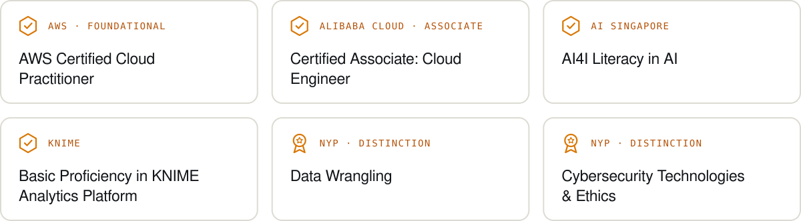
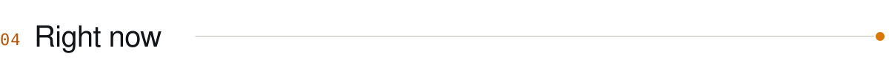
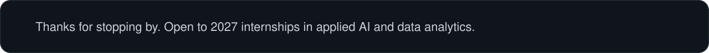

<!--
  Profile README for github.com/ItsEnChengg
  This file and the assets/ folder go in a public repo named exactly ItsEnChengg.
  The images are generated by tools/build.py (see tools/README.md).
  Stack icons are from tandpfun/skill-icons (MIT, see assets/ICONS-LICENSE.txt).
-->

  

  
  
  

 

<picture>
  <source media="(prefers-color-scheme: dark)" srcset="./assets/dark/h-about.svg" />
  
</picture>

I'm En Cheng, a second-year student in the Diploma in Applied AI & Analytics at Nanyang Polytechnic, Singapore.

I like building software where the AI is useful *and* checkable. Most recently I led a team of three to build a factory management information system for a real food manufacturer, with plain-English analytics, a role-aware AI assistant and in-browser person detection. It was graded A, and our team was picked to present it to the client.

I'm looking for a **2027 internship in applied AI or data analytics**, and after my diploma I'm aiming for a university degree in analytics or computing.

 

<picture>
  <source media="(prefers-color-scheme: dark)" srcset="./assets/dark/h-toolkit.svg" />
  
</picture>

<picture>
  <source media="(prefers-color-scheme: dark)" srcset="./assets/dark/stack.svg" />
  
</picture>

<picture>
  <source media="(prefers-color-scheme: dark)" srcset="./assets/dark/toolkit.svg" />
  
</picture>

 

<picture>
  <source media="(prefers-color-scheme: dark)" srcset="./assets/dark/h-credentials.svg" />
  
</picture>

<picture>
  <source media="(prefers-color-scheme: dark)" srcset="./assets/dark/credentials.svg" />
  
</picture>

 

A grades in Programming, Statistical Research Methods, Data Structures & Algorithms, Web Development Project, and Full Stack Application Development.

 

<picture>
  <source media="(prefers-color-scheme: dark)" srcset="./assets/dark/h-now.svg" />
  
</picture>

- **Studying:** Year 2, Semester 2, including a Linux module and my MLOps capstone.
- **Looking for:** a 2027 internship in applied AI or data analytics.
- **Next certification:** AWS Solutions Architect.
- **Also:** subcommittee member at NYP Cloud Computing.

 

  

  
  

